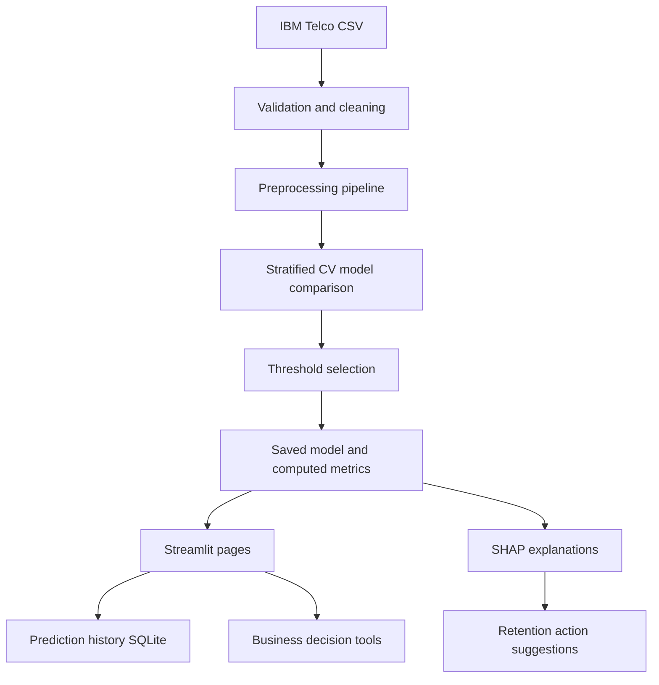

# RetainAI — Customer Churn Prediction & Retention Intelligence

**Predict customer churn, understand modelled risk drivers, and explore retention decisions with an explainable analytics app.**

> Important: This repository contains the complete application source. The IBM Telco CSV and trained model artifacts are generated/added locally; no metrics are fabricated or pre-populated. Train the model on the dataset you supply before using the app.

## Features

- IBM Telco data validation and cleaning (`TotalCharges` blanks handled as missing values).
- Leakage-safe scikit-learn preprocessing pipeline.
- Logistic Regression, Random Forest and XGBoost comparison using stratified cross-validation.
- Class imbalance handling with class weights / `scale_pos_weight`.
- Churn-class precision, recall, F1, ROC-AUC, average precision and confusion matrix.
- Out-of-fold F1-based decision threshold selection.
- SHAP global and per-customer explanations.
- Dashboard with contract, internet, payment and tenure segmentation.
- Single customer predictor, what-if simulator and bulk CSV scoring.
- Segment explorer with optional K-Means.
- Threshold and assumption-driven retention ROI tools.
- SQLite prediction history and bcrypt password hashing.
- One-click individual-customer and batch-summary PDF reports.

## Architecture



## Requirements

- Python 3.11
- VS Code (recommended)
- Windows, macOS or Linux

## Setup

### 1. Download and place the dataset

The app automatically downloads the IBM Telco CSV from IBM's public sample repository on first run and verifies its SHA-256 checksum. You can also place the CSV manually at `data/WA_Fn-UseC_-Telco-Customer-Churn.csv`. See `data/README.md`.

### 2. Create a virtual environment

Windows PowerShell:

```powershell
python -m venv .venv
.venv\Scripts\Activate.ps1
```

macOS/Linux:

```bash
python3 -m venv .venv
source .venv/bin/activate
```

### 3. Install dependencies

```bash
python -m pip install --upgrade pip
pip install -r requirements.txt
```

### 4. Train the model

```bash
python -m src.train.train_model
```

This creates `models/churn_model.joblib`, `models/metrics.json` and reports. The metrics are computed from the actual dataset and held-out test split.

### 5. Launch the application

```bash
streamlit run app/main.py
```

Open the local URL printed by Streamlit.

## Tests

```bash
pytest -q
```

## Project structure

```text
app/                  Streamlit entry point and multipage UI
src/data/             Dataset loading and validation
src/features/         Reusable preprocessing
src/train/            Model comparison, tuning and evaluation
src/explain/          SHAP explanation engine
src/recommend/        Rule-based action suggestions
src/db/               SQLite models and authentication helpers
models/               Locally generated model and metrics
data/                 User-provided dataset
reports/              Generated evaluation outputs
tests/                Unit tests
.github/workflows/    CI workflow
```

## Metrics

No metric values are hardcoded in this README. After training, see `models/metrics.json` for the actual selected model, test-set metrics, confusion matrix and cross-validation comparison. Report precision, recall and F1 for the churn class, plus ROC-AUC. Accuracy alone is not sufficient for an imbalanced churn dataset.

## Assumptions and limitations

- The IBM Telco dataset is small and public; it is not representative of every SaaS or fintech business.
- SHAP describes the trained model's behaviour; it does not establish causation.
- The what-if simulator shows model response to changed inputs, not a causal intervention effect.
- Revenue-risk calculations use monthly charges as a proxy and should not be interpreted as audited revenue forecasts.
- ROI inputs (offer cost, lifetime value, acceptance rate and retention success rate) are user-entered assumptions.
- Rule-based retention actions are hypotheses for human review, not guaranteed interventions.
- Local SQLite authentication is a portfolio/demo implementation, not enterprise-grade identity management.
- For Streamlit Community Cloud, commit the dataset only if its licence permits it, or configure a private data source. Train the model during build/deployment or provide compatible artifacts through secure storage. Model artifacts and data are excluded from Git by default.

## Deployment to Streamlit Community Cloud

1. Push this repository to GitHub.
2. Ensure the dataset is available through a permitted deployment method.
3. Ensure the trained model artifact is generated in the deployment environment or securely provided.
4. Create a Streamlit Community Cloud app pointing to `app/main.py`.
6. Set Python to 3.11 if the deployment configuration allows it.

## Resume bullets (update with measured results after training)

- Built RetainAI, a modular Streamlit customer churn analytics application with leakage-safe preprocessing and comparative Logistic Regression, Random Forest and XGBoost modelling.
- Evaluated churn-class precision, recall, F1 and ROC-AUC using stratified cross-validation and a held-out test set; documented actual metrics generated from the IBM Telco dataset.
- Implemented SHAP-based global and local model explanations, bulk scoring, segment analysis and assumption-driven retention decision tools.

## Future work

- Add a polished PDF retention brief and batch report export.
- Add richer SHAP interactive waterfall and beeswarm visualizations in the app.
- Add calibration analysis, cost-sensitive threshold optimization and temporal validation.
- Add production identity management, audit logs and deployment data governance.
